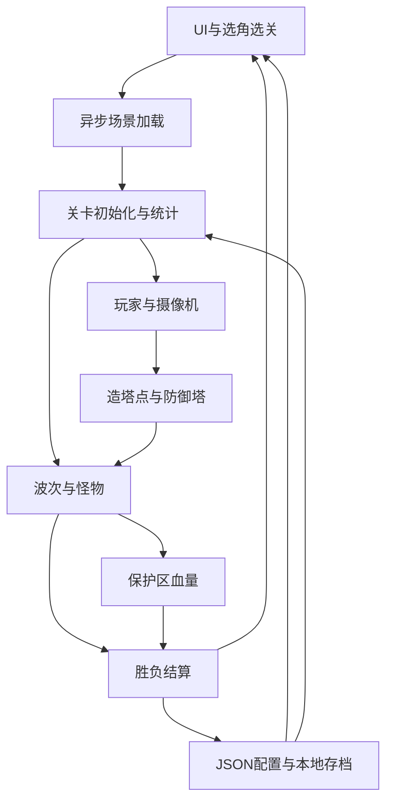

# 《丧尸围城》八模块总结

本总结对应 2026-10-24 的练习项目交付。用户已完成 Windows 打包并反馈运行正常；Agent 实际操作了菜单至失败结算和返回流程，用户另提供建造、升级、开火与胜利画面。模块实现依据当前代码，验证依据区分运行观察、用户演示和静态检查。

总览：[项目功能与截图](Practice-Demo-Overview.md) · [简历描述](Practice-Demo-Resume.md)。

## 模块关系

## 1. UI

**职责与实现。** `BasePanel` 管理 `CanvasGroup`、显示状态和隐藏完成回调；`UIManager` 从 Resources 创建常驻 Canvas，并用面板类型名缓存实例。开始、设置、选角、选关、游戏、提示、结算面板各自处理展示和交互。

**实现取舍。** 血条用 Slider；建塔区域用水平与垂直布局；图标使用 Button 承载，但当前建造入口为键盘。淡入淡出使用 `unscaledDeltaTime`，结束面板在游戏时间暂停后仍能显示。

**复盘。** 修正过透明度结束条件无法进入回调，以及换父对象时保留世界坐标导致 UI 偏移的问题。理解“透明”“隐藏”“销毁”“停止拦截射线”是不同状态。

**验证。** Agent 截取并操作了主菜单、设置、选角、选关及失败结算；用户提供成功和建塔 UI。多宽高比未专项验收，升级提示图底部文字存在裁切，不把布局组件等同于所有分辨率适配通过。

## 2. 数据

**职责与实现。** `GameDataMgr` 加载角色、场景、怪物与防御塔 JSON，保存当前选择；`JsonMgr` 使用 LitJson 读写数据。静态配置位于 StreamingAssets，金币、解锁列表与音乐设置保存到 persistentDataPath。

**配置范围。** 7 条角色、16 条怪物组合、9 条塔、3 条场景入口。塔的 `next` 表示下一级 ID，0 表示满级；列表下标和配置 ID 分别处理。

**协作与复盘。** 本人确定基础配置与规则，Agent 补齐怪物数据、生成数据类/JSON并同步资源路径。修正过 `atkOffset` 名称不一致、图片名与路径不符。资源存在还不够，图片还需以 Sprite Single 导入才能按 Sprite 加载。

**验证与边界。** 静态路径和字段对应已经检查，Agent 观察到一次结算后金币增加；跨进程保存未单独复测。怪物 Excel 的速度参数与当前 JSON 的运行值存在历史差异，再次导出前应核对，不能将临时转写描述为通用配置流水线。

## 3. 场景

**职责与实现。** `ChooseScenePanel` 展示名称、说明与预览图，用 `LoadSceneAsync` 加载选中场景，完成后调用 `GameLevelMgr.InitInfo()`。Build Settings 包含 BeginScene 与三个 GameScene。

**关键衔接。** 加载前同步选关列表下标，加载后创建游戏面板、实例化所选角色、设置摄像机跟随目标，并初始化保护区血量和金币。

**复盘。** 开始按钮淡出时仍能被再次点击，曾触发重复加载并重复累加波数；回调开头禁用按钮后修复。选关预览用的下标也需要同步给关卡初始化，不能只加载正确场景却读第一条参数。

**验证与边界。** Agent 在独立包完成一次选关加载及失败后返回；用户报告整体运行正常。三关有各自入口，不据此声称三套独立关卡美术设计或全部路径组合均测过。

## 4. 摄像机

**职责与实现。** 菜单通过 `CameraAnimator` 的 Trigger 播放左右转场，动画末尾事件调用 `PlayOver()` 执行并清空回调。游戏中 `CameraMove` 根据角色位置、forward/right 偏移计算目标位置，使用 Lerp/Slerp 平滑跟随和转向。

**复盘。** 区分摄像机自身位置与角色目标位置，也区分一次性的过场回调与每帧跟随。方向向量与位置相加的时机影响旋转中心，相关理论复盘可迁移到角色瞄准。

**验证与边界。** Agent 观察到菜单镜头切换和进入战斗后的跟随视角；没有对镜头碰撞避障进行实现或验收，场景物体遮挡属于后续可改善项。

## 5. 玩家

**职责与实现。** `PlayerObject` 读取移动轴和鼠标转向，驱动 Animator 参数及翻滚、开火、下蹲表现；角色 Prefab 启用 Root Motion。伤害通过动画事件调用：近战用 OverlapSphere，枪械用射线查询，再处理怪物受伤与命中特效。金币增减统一经玩家接口更新 HUD。

**动画配置。** 本人手动完成角色 1 原控制器和角色 2 首个 Override；角色 3～7 的覆盖映射由 Agent 按武器类别批量完成。七个 Prefab 的组件、枪口引用也有 Agent 协助记录。

**复盘。** 近战判定曾因模型缩放、碰撞体与查询球的位置关系导致命中数为零；扩大半径仅用于定位，最终结合角色比例和 CharacterController 调整。没有把“画面上贴近”当作物理范围一定相交。

**验证与边界。** 用户此前确认近战命中，并提供本次角色开火截图；Agent 观察了两种武器的角色预览。不同枪械共用射线伤害入口，模型和动画变化不等于独立弹道系统。

## 6. 怪物

**职责与实现。** `MonsterObject` 接收配置，设置 NavMeshAgent 参数及 Animator Controller。出场动画事件开始寻路，攻击事件对保护区判定伤害；受伤更新血量与动画，死亡停止导航并奖励金币，死亡动画结束后减少关卡存活数并销毁对象。

**配置与复用。** 四个模型与四类动画形成 16 条数据组合；本人完成 Aggresive 原控制器，Agent 创建 Broken、Calm、Crawl 覆盖控制器。Generic 动画作为各类共用素材。

**复盘。** 组件、动画事件和数据字段必须一一对应；死亡时的逻辑状态与死亡动画完成是两个时刻，存活数的更新位置决定何时能结算。

**验证与边界。** 运行与用户截图可见怪物接近安全区和参与战斗；16 条数据组合是静态配置成果，未声称每一组合都单独跑通完整动画流程。

## 7. 关卡

**职责与实现。** `MonsterPoint` 管理波次、每波数量和生成间隔；`GameLevelMgr` 登记出怪点、统计剩余波次与存活数。所有点生成完毕且怪物清空时判胜，保护区归零判负，结束面板发放并保存奖励。

**时序复盘。** Invoke 是预约调用，不阻塞当前方法；下一波应在本波最后一只生成后预约。关卡重新进入前清理出怪点列表和全局计数，避免上一局状态残留。

**暂停与界面。** 结算面板设 `timeScale=0`，UI 使用不缩放时间渐显；回到开始面板恢复时间。结算后仍可能接受玩法按键是用户明确接受的练习边界，不在本次继续扩展。

**验证。** Agent 跑通失败与返回，用户提供剩余波数 0/10、保护区血量仍大于 0 的成功画面。Agent 截图中同一进程的金币由 6325 变为 6425，证明该次奖励回流可见；不是跨进程存档测试。

## 8. 防御塔

**职责与实现。** `TowerPoint` 负责玩家触发、金币检查、扣费、Prefab 创建与升级替换；`TowerObject` 负责范围搜索、目标选择、转向、冷却和伤害；`TowerBtn` 与 GamePanel 负责图标、价格和数字键/空格提示。三类各三级共 9 条配置，`next=0` 结束升级。

**核心取舍。** 使用 Physics 查询自行实现寻敌；单体攻击对准目标后伤害一次，范围攻击在一次冷却检查后遍历命中对象。枪口特效与伤害分开处理，没有物理炮弹或对象池的性能声明。

**复盘。** 先选目标、再生成瞄准点；修改位置副本而非真实怪物 Transform；伤害使用同一 `_target`。玩家筛选使用 layer 与 NameToLayer 的编号比较，区分层编号与 GetMask 位掩码。

**验证与分工。** Agent 为九个本地 Prefab 配置枪口/炮头引用并静态核对；本次用户截图展示三类建造选项、升级费用提示、不同塔共存及升级后外观。它们补充了可见功能证据，不据单张图断言所有升级组合与极端场景均通过。

## 可复用结论

- 本人保留需求、规则、主要逻辑与联调责任，Agent 处理可描述规则的重复工作，输出结果仍需核对。
- 保存范围、对象层级、数据下标、时间基准与生命周期是这次调试的主要线索。
- 最终作品证据是代码、可运行包、截图与复盘相互对应；不能把编译通过、单次成功或截图里的特效当成全面验收与性能证明。
