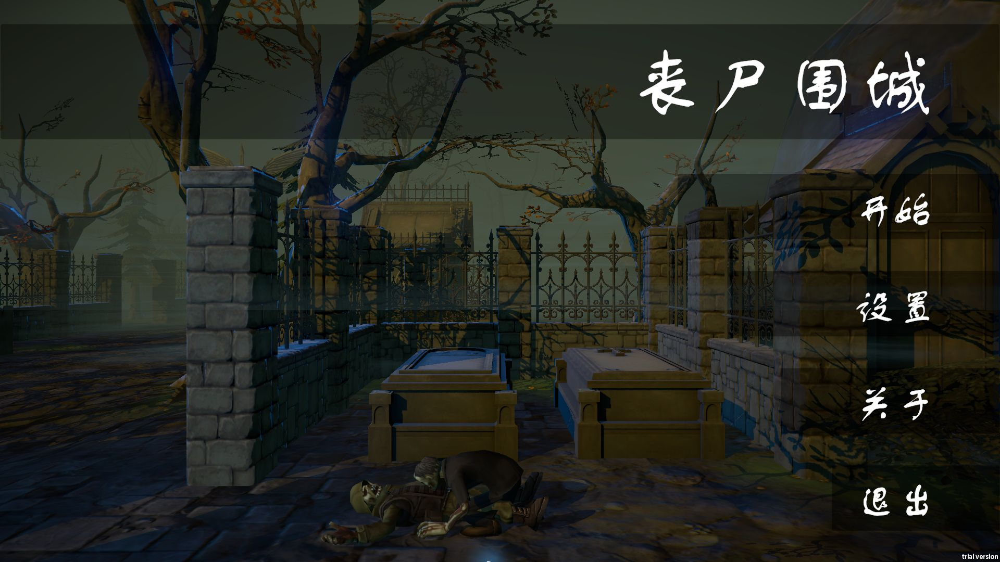
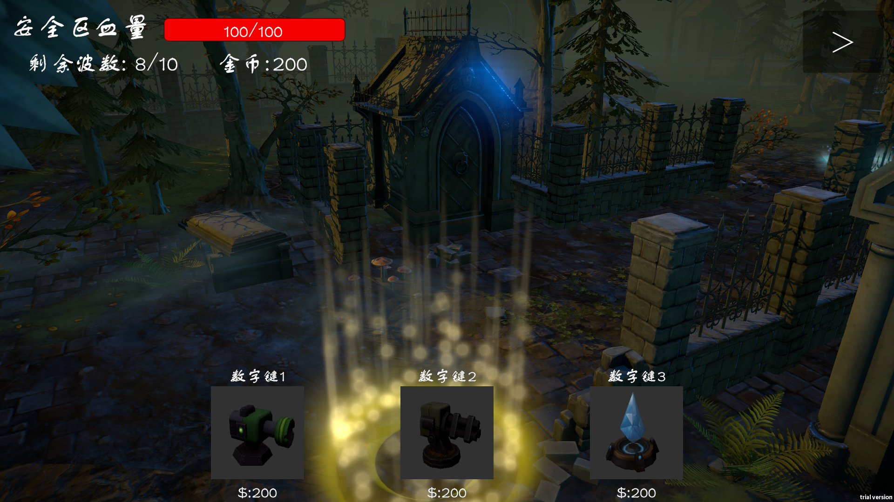
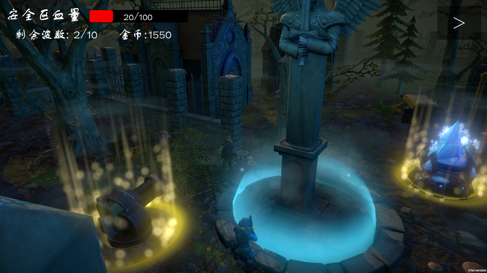
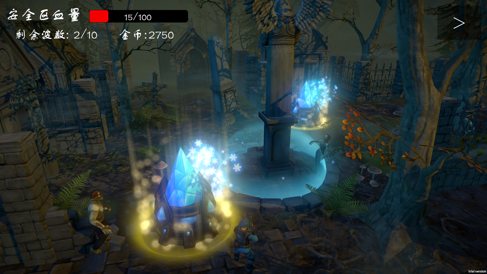
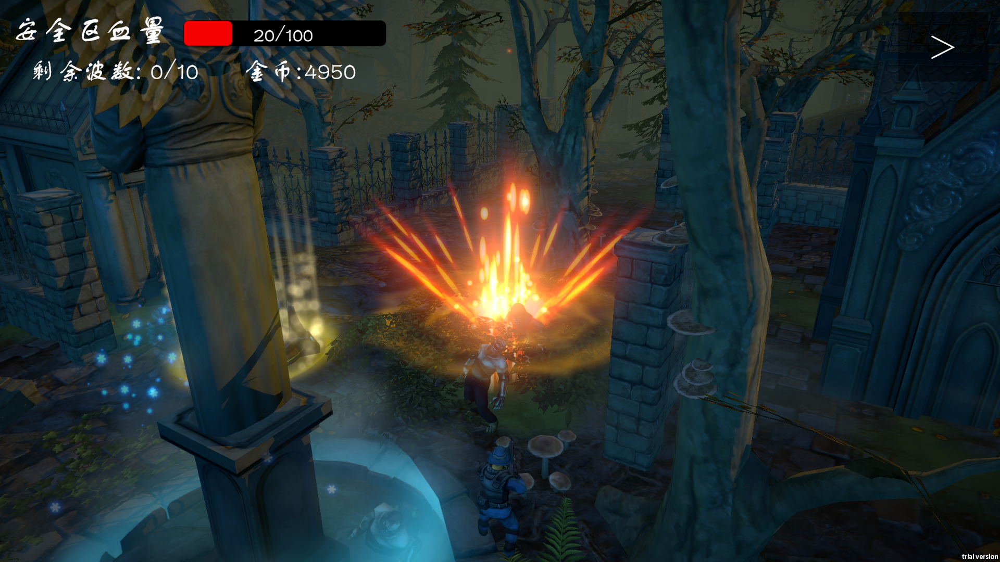
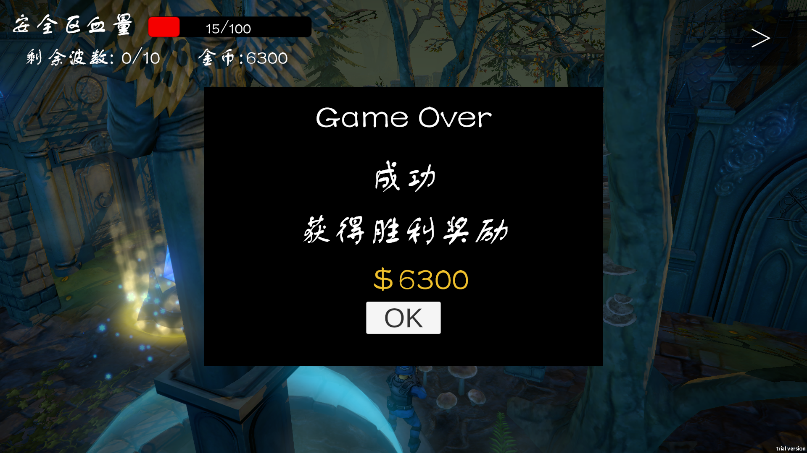

# 《丧尸围城》：Unity 3D 防守射击 Demo

这是一个使用 Unity 6 和 C# 完成的个人学习型项目。玩家选择角色和关卡，在第三人称视角下参与战斗，并使用金币建造、升级防御塔，保护安全区抵御分波出现的怪物。项目已完成 Windows 独立包，串联了开始菜单、角色选择、关卡加载、战斗、建塔、胜负结算和奖励回流。

项目以教程为基础开展，主要玩法与 UI 流程由本人编写和联调；模型、动画、音频、场景美术来自教学/第三方资源。AI Agent 协助了批量资源配置、数据转写、检查和资料整理，分工见下文。

## 项目信息

| 项目 | 内容 |
| --- | --- |
| 类型 | 第三人称角色战斗与塔防结合的单机练习 Demo |
| 引擎与平台 | Unity 6000.3.10f1，3D Built-In，Windows |
| 核心技术 | C#、UGUI、TextMesh Pro、Animator / Animator Override Controller、动画事件、NavMeshAgent、Physics 查询、Resources、LitJson / JSON |
| 数据范围 | 7 条角色配置、16 条怪物配置、3 类各 3 级共 9 条塔配置、3 个可选关卡入口 |
| 当前成果 | 可运行的 Windows 构建、功能截图、源码与复盘文档 |
| 相关资料 | [截图索引](../Screenshots/Practice-Demo/README.md) · [简历项目描述](Practice-Demo-Resume.md) · [八模块总结](Practice-Demo-Modules.md) · [打包前检查](Practice-PreBuild-Review.md) |

这些数量描述配置和入口，不表示全部组合已逐一穷举测试，也不把 3 个关卡入口描述成 3 套独立美术关卡。

## 玩法流程

1. 在开始菜单打开音量设置，或通过摄像机过场进入角色预览。
2. 左右切换角色，查看当前金币及解锁条件，选择已解锁的角色进入选关。
3. 加载所选场景，初始化角色、摄像机、安全区血量、战斗金币和波次 UI。
4. 怪物按波次生成，沿 NavMesh 前往安全区；玩家通过近战或枪械攻击参与防守。
5. 进入造塔点后，用数字键选择塔型，金币足够时建造；已有塔用空格键升级，满级后关闭升级入口。
6. 怪物生成完毕且存活数归零时胜利；安全区血量归零时失败。结束面板显示奖励，返回菜单后可再次开始。

## 功能清单

| 模块 | 已实现内容 | 核心代码 |
| --- | --- | --- |
| UI | 面板基类、类型名缓存、淡入淡出、设置、选角、选关、战斗 HUD、结算 | `BasePanel`、`UIManager` 及各面板 |
| 数据与存档 | 角色/怪物/关卡/塔的 JSON 配置，金币、角色解锁、音量设置保存 | `GameDataMgr`、`JsonMgr`、数据类 |
| 场景 | 选关预览、异步加载、加载完成后的统一初始化、再次进入前清理计数 | `ChooseScenePanel`、`GameLevelMgr` |
| 摄像机 | 菜单镜头过场及动画结束回调；游戏中按角色位置/朝向计算跟随位置和朝向 | `CameraAnimator`、`CameraMove` |
| 玩家 | Animator 参数驱动移动表现，翻滚、下蹲、鼠标转向；近战范围与枪械射线判定 | `PlayerObject` 与角色 Animator |
| 怪物 | 配置初始化、NavMesh 寻路、受击/攻击/死亡动画、动画事件衔接 | `MonsterObject`、怪物 Animator |
| 关卡与结算 | 波次调度、存活数统计、安全区扣血、胜负判断、奖励入账及时间暂停 | `MonsterPoint`、`GameLevelMgr`、`MainTowerObject`、`GameOverPanel` |
| 防御塔 | 单体/范围攻击、寻敌与转向、冷却、特效、金币检查、建造和升级替换 | `TowerObject`、`TowerPoint`、`TowerBtn`、`GamePanel` |

## 代表性运行画面

### 建造选择

玩家进入造塔范围后显示三类塔的图标、价格和数字键提示；实际创建前检查金币。截图由用户提供。

### 防守与升级

角色、炮塔和水晶塔共同参与防守，HUD 显示安全区血量、剩余波数和金币。升级使用配置中的 `next` 指向下一级，替换旧塔并更新展示。截图由用户提供。

### 角色攻击与结算

角色攻击通过动画事件衔接伤害判定与命中特效。成功界面包含结果、奖励和返回入口；下列两图由用户提供。

## 相对教程的主动调整

- 血条采用 Slider，通过数值驱动填充显示。
- 建塔选项使用父级水平布局、子级垂直布局，减少手工排列坐标。
- 塔图标使用 Button 承载，为之后扩展鼠标交互保留入口；当前实际建造操作仍为数字键和空格，Alt/鼠标点击方案没有计入完成功能。
- 塔寻敌使用物理范围查询，自行完成目标选择、瞄准点更新和伤害对象的一致性处理。
- 面板淡入淡出改用 `Time.unscaledDeltaTime`，使游戏时间暂停后结算 UI 仍能渐显和响应。

这些是具体实现取舍，没有把它们描述为未经测量的性能优化。

## 验证依据

| 依据 | 已确认的范围 |
| --- | --- |
| 用户反馈 | 已打包且运行正常；提供建造、升级、攻击和胜利截图 |
| Agent 实际运行独立包 | 主菜单、设置打开/关闭、角色切换、选关、进入战斗、失败结算、返回菜单再次进入选角 |
| 可见结果 | 失败奖励为 100；同一进程返回选角后金币由 6325 增至 6425；用户成功截图显示 6300 奖励 |
| 静态检查 | 数据资源路径、主要 GUID、角色与塔组件引用、场景构建列表、Player 层判断及选关下标同步 |
| 编译 | 主工程 0 Error；此前连同 Editor 程序集检查也为 0 Error，保留旧资源等 Warning |
| 尚未专项覆盖 | 全部角色/怪物/塔组合、全新存档及跨进程持久化、多宽高比、性能测试 |

运行截图中的波数按该包的实际配置展示为 10。早期复盘中的 2 波或打包前静态快照中的单点 5 波属于当时配置，不用它们覆盖实际截图。

## 个人工作与 AI Agent 协作

| 分工 | 实际工作 |
| --- | --- |
| 本人 | 编写并联调主要 UI、场景、角色、怪物、波次、胜负、造塔升级逻辑；完成原版角色 Animator、首个角色 Override 和 Aggresive 怪物原控制器；确定配置规则；打包、运行并补充战斗截图 |
| AI Agent | 依据原版创建角色 3～7 的覆盖控制器；批量生成 3 个怪物覆盖控制器；补齐 12 条怪物配置及相应数据结构；生成塔数据结构/JSON、同步资源路径；按授权配置角色组件与枪口、9 个塔的枪口/炮头引用；静态复查、调试解释、截图和文档 |
| 教学/第三方素材 | 模型、动画、音频、特效和环境美术；本项目侧重功能整合与逻辑实现，不将这些素材说成原创制作 |

协作过程可核对：[角色 Animator](Practice-Character-Animator-Overrides.md)、[怪物 Animator](Practice-Monster-Animator.md)、[怪物数据](Practice-Monster-Data.md)、[塔数据与 Prefab](Practice-Tower-Data.md)。

## 练习范围与后续空间

当前作品用于展示完整功能闭环、Unity 组件协作和调试能力。关于入口仍为占位，Alt/鼠标建造为后续设想；结算后仍可能响应底层玩法按键是用户已接受的练习边界。死亡目标过滤、镜头遮挡、部分 UI 文本裁切等可留作后续完善。

本机 Windows 包在 `Builds/`，该目录不进入 Git；原教学素材也按既有约定排除。源码仓库可用于查看本人实现与学习记录，恢复 Unity 工程需自行准备对应本地素材。
